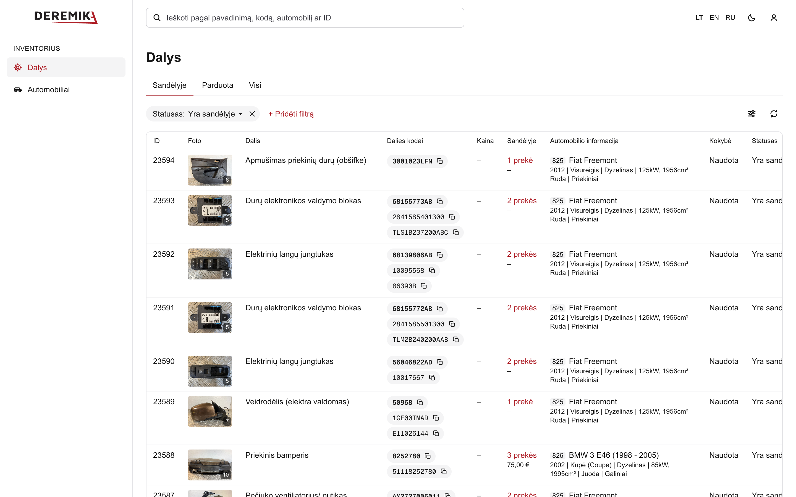
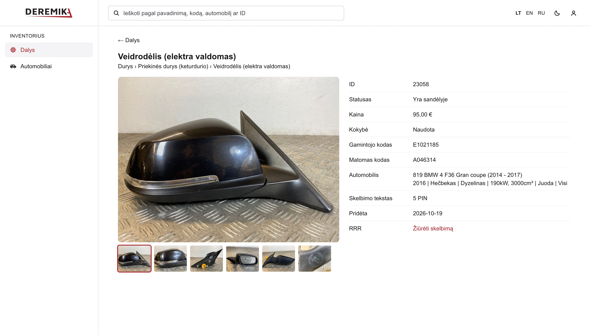
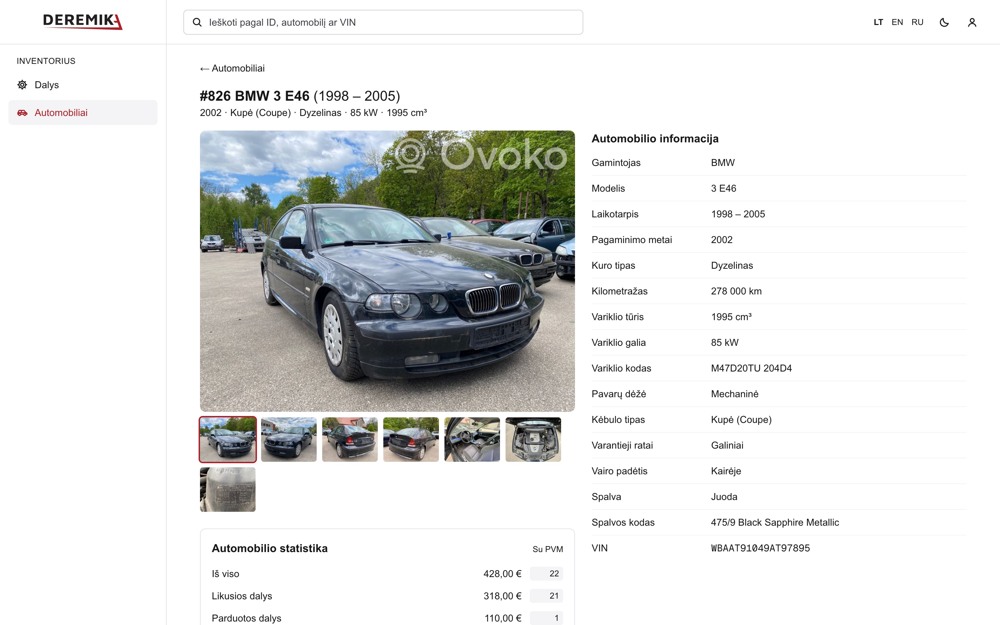
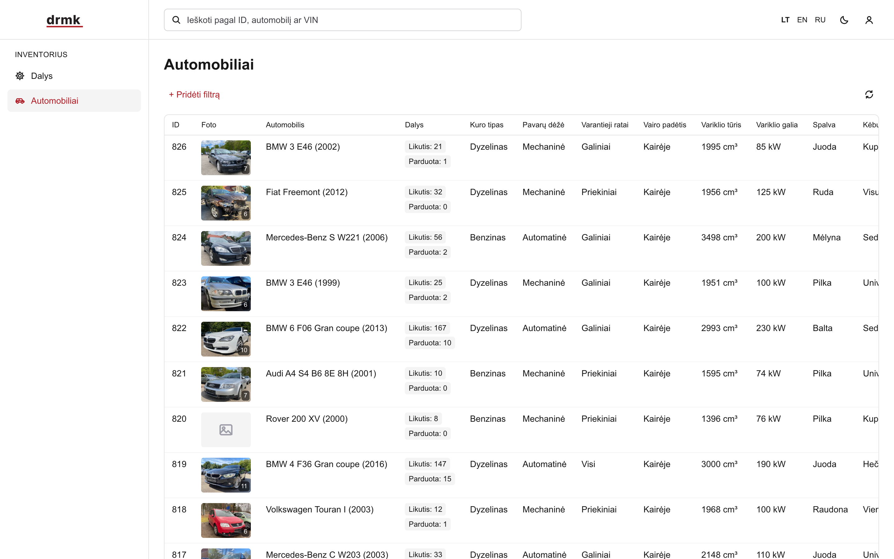
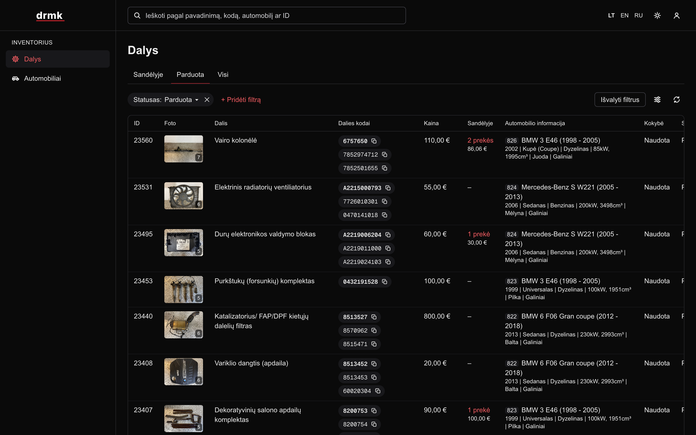
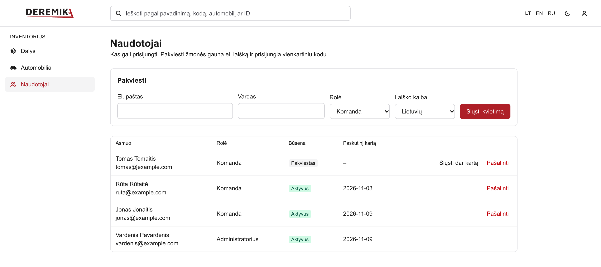
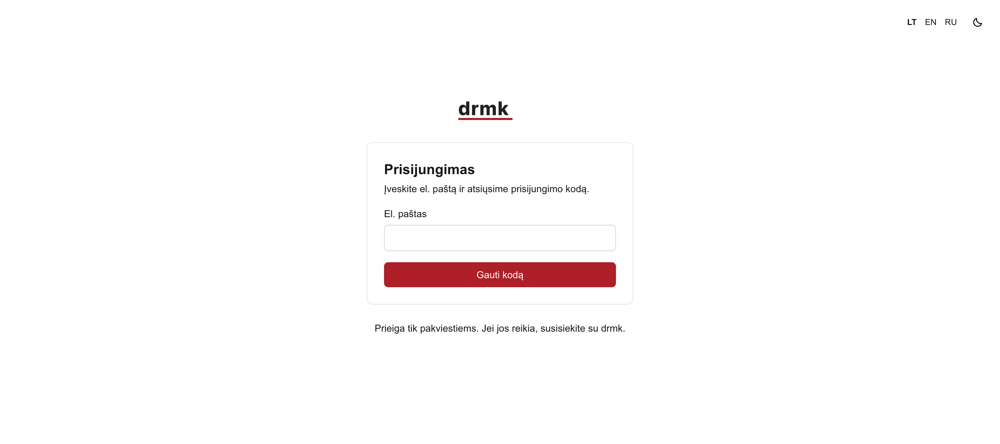
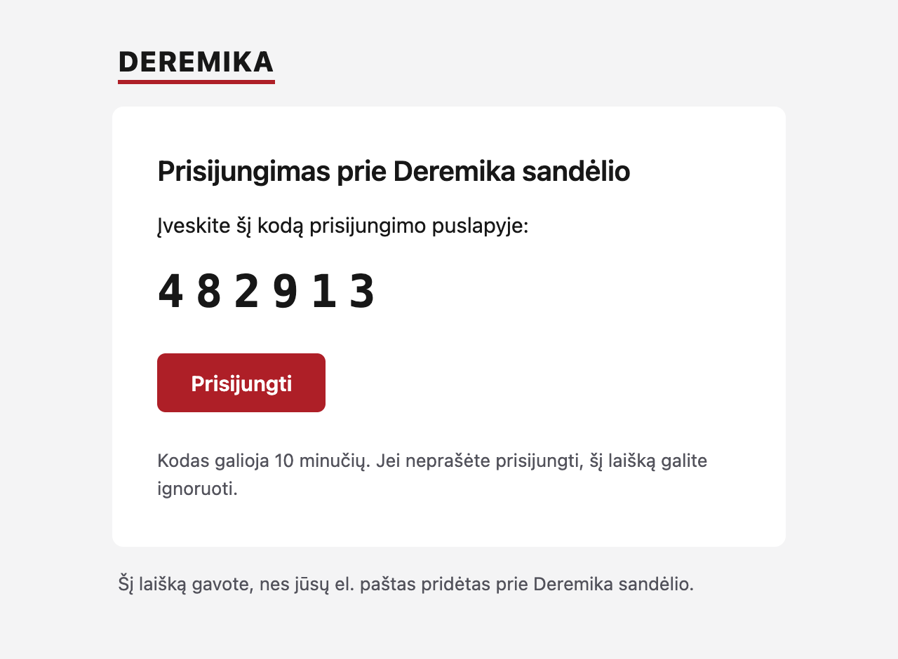

# drmk-inventory-sync

An ever-updating backup of a used auto-parts inventory on RRR (rrr.lt / Ovoko), with a dashboard to browse it. Every part, donor car and photo is copied into our own database and storage every 15 minutes, so the data is ours even if RRR is down or we move elsewhere. The dashboard is invite-only: admins invite team members and guests by email, and decide who sees what.



## What it does

- **Keeps an up-to-date backup.** Parts sync from RRR every 15 minutes, with a full check every night that also catches deletions. Donor cars and RRR's catalogue (makes, models, categories) come along, translated into Lithuanian, English and Russian. Photos are copied to our own Cloudflare R2 storage. Removed parts are kept, marked as removed.
- **Lets people browse it.** A fast dashboard for parts and cars, with search, filters, column settings, photo galleries and RRR's "Sandėlyje" stock figures. Lithuanian, English and Russian, in light and dark.
- **Invites guests.** There are no passwords and no public sign-up. Someone gets in only when an admin invites their email. They sign in with a one-time code from an email in our own design.
- **Gives admins control.** Admins invite people, choose their role and remove access. Admins also see what others don't: reservations and parts without a price.

| Part                                         | Car                                            |
| -------------------------------------------- | ---------------------------------------------- |
|       |           |
| **Cars**                                     | **Dark theme**                                 |
|       |  |
| **Users (admins only)**                      | **Sign-in**                                    |
|     |     |
| **Sign-in email**                            |                                                |
|  |                                                |

The screenshots use a placeholder brand and placeholder people, and staff names are hidden.

## How it fits together

```text
Cloudflare Worker (apps/scheduler)
  │  starts workflows on time
  ▼
GitHub Actions ── runs ──▶ apps/worker
                            ├─ reads parts and cars from the RRR API
                            ├─ writes them to Supabase Postgres
                            └─ copies photos from Ovoko to Cloudflare R2

Cloudflare Worker (apps/web), on the brand's own domain
  ├─ reads Postgres through Hyperdrive
  ├─ shows photos from R2
  └─ signs people in, with codes sent through Resend
```

## Layout

| Path                                                   | What it is                                                 |
| ------------------------------------------------------ | ---------------------------------------------------------- |
| [`apps/web`](apps/web/README.md)                       | The dashboard: Next.js on Cloudflare Workers, with sign-in |
| [`apps/worker`](apps/worker/README.md)                 | Sync and photo jobs                                        |
| [`apps/scheduler`](apps/scheduler/README.md)           | Cloudflare Worker that starts the jobs on time             |
| [`packages/db`](packages/db/README.md)                 | Drizzle schema, migrations and database client             |
| [`packages/rrr-client`](packages/rrr-client/README.md) | Typed client for the RRR API                               |

## Getting started

Needs Node 24 (`.ts` files run directly, with no build step) and pnpm.

```bash
pnpm install
```

```bash
cp .env.example .env
```

Fill in `.env`. It is gitignored, so credentials never reach the repo. Then check the RRR connection:

```bash
pnpm smoke:rrr
```

To use the dashboard locally, add yourself as an admin, then run it and sign in at <http://localhost:3000/login>:

```bash
pnpm users:add you@example.com admin
```

```bash
pnpm dev:web
```

Without `RESEND_API_KEY` in `.env`, the sign-in code is printed in the terminal instead of emailed.

## Who sees what

Access is invite-only. A row in `auth_users` is what lets an email sign in, and an admin creates it from the Users page.

|                                        | Admin | Everyone else                    |
| -------------------------------------- | ----- | -------------------------------- |
| Parts, cars, photos, prices and stock  | Yes   | Yes                              |
| Reservations: status, who and when     | Yes   | No: reserved parts look in stock |
| The "without price" tab and filter     | Yes   | No                               |
| The Users page: invite, resend, remove | Yes   | No                               |

These rules run on the server, in the data layer, so editing the address doesn't get around them. Removing someone takes effect within 5 minutes.

## Translations

Interface text lives in `apps/web/src/messages`, one JSON file per language. Add a key to `lt.json` first; a key missing from `en.json` or `ru.json` fails the typecheck. Visitors pick a language in the header, and it's saved in a cookie. Emails use the language chosen when the person was invited, or the one they're using when they sign in.

Part names, categories and car details come translated from RRR's catalogue, and fall back to Lithuanian if a translation is missing. Listing text stays as the team wrote it.

## Commands

| Command                                         | What it does                                                                                        |
| ----------------------------------------------- | --------------------------------------------------------------------------------------------------- |
| `pnpm dev:web`                                  | Runs the dashboard locally                                                                          |
| `pnpm web:preview`                              | Builds the dashboard and runs it in the Cloudflare runtime locally                                  |
| `pnpm web:deploy`                               | Builds and deploys the dashboard to Cloudflare by hand                                              |
| `pnpm users:add <email> [admin\|member]`        | Lets an email sign in without sending an invite. For the first admin                                |
| `pnpm typecheck`                                | Typechecks every package                                                                            |
| `pnpm format` / `pnpm format:check`             | Formats or checks the repo with Prettier                                                            |
| `pnpm db:generate` / `db:migrate` / `db:studio` | Creates or applies migrations, opens Drizzle Studio                                                 |
| `pnpm sync:incremental` / `pnpm sync:full`      | Runs an RRR sync                                                                                    |
| `pnpm sync:cars [all]`                          | Refreshes donor cars: the newest page, or with `all` every car plus the model and category catalogs |
| `pnpm images:rehost [limit]`                    | Copies pending photos to R2                                                                         |
| `pnpm scheduler:deploy`                         | Deploys the Cloudflare scheduler                                                                    |

## Scheduled jobs

All three are started by `apps/scheduler`. Times are UTC.

| Workflow               | When             | What it does                                                      |
| ---------------------- | ---------------- | ----------------------------------------------------------------- |
| `rrr-sync-incremental` | Every 15 minutes | Pulls parts changed on RRR and queues their new photos, then cars |
| `rrr-sync-full`        | Nightly at 02:41 | Walks every part and car, catching deletes and anything missed    |
| `images-rehost`        | Hourly at :17    | Copies 95 photos, in-stock covers first                           |

Any of them can also be started by hand from the repo's Actions tab.

## Secrets

| Where                                 | What                                                                                                                                                             |
| ------------------------------------- | ---------------------------------------------------------------------------------------------------------------------------------------------------------------- |
| `.env`                                | Everything in `.env.example`, for local runs                                                                                                                     |
| GitHub → Settings → Secrets → Actions | `DATABASE_URL`, `RRR_USERNAME`, `RRR_PASSWORD`, `RRR_USER_TOKEN`, `R2_ACCOUNT_ID`, `R2_ACCESS_KEY_ID`, `R2_SECRET_ACCESS_KEY`, `R2_BUCKET`, `R2_PUBLIC_BASE_URL` |
| Cloudflare Worker `drmk-web`          | `BETTER_AUTH_SECRET`, `RESEND_API_KEY`, set with `wrangler secret put`. The database comes through Hyperdrive                                                    |
| Cloudflare Worker `drmk-scheduler`    | `GITHUB_TOKEN`                                                                                                                                                   |

This repo is public, and so are its Actions logs. Don't commit credentials or print part data in job output.

The dashboard's build would otherwise copy every `.env` value into the Worker, so `pnpm web:deploy` strips them out and refuses to deploy if any remain. Deploy with that command, not `wrangler deploy` directly.

## Status

The backup, the dashboard and invite-only sign-in are done and running. Next steps and known gaps are in [TODO.md](TODO.md).

Two larger plans are on hold for now:

- Editing stock from the dashboard and pushing the changes back to RRR.
- Listing parts on several marketplaces, with our database as the source of truth.
